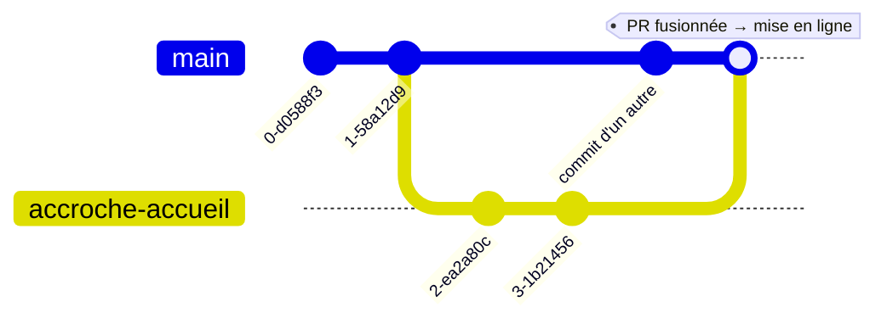
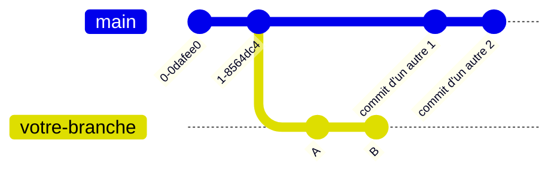
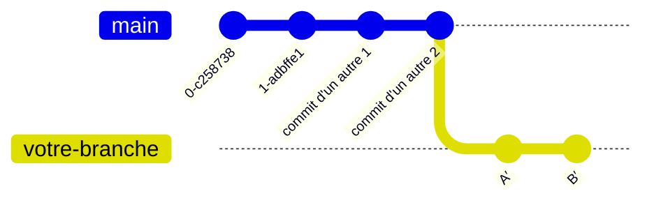

# Contribuer au site du PIV

Comprendre comment le site est construit, modifier son contenu sans écrire de code, puis, si besoin, contribuer au code étape par étape. Aucune connaissance préalable du développement web n'est nécessaire.

Dépôt **hamidsefati/piv** (privé) · Contenu **sans installation** · Code **≈ 1 h d'installation** · Mis à jour **octobre 2026**

**Sommaire**

1. [Le parcours](#1-le-parcours)
2. [Comment fonctionne le site](#2-comment-fonctionne-le-site)
3. [Modifier le contenu sans coder](#3-modifier-le-contenu-sans-coder)
4. [Quand faut-il un développement ?](#4-quand-faut-il-un-développement-)
5. [Créer un compte GitHub](#5-créer-un-compte-github)
6. [Rejoindre le projet](#6-rejoindre-le-projet)
7. [Installer les outils](#7-installer-les-outils)
8. [Configurer Git et GitHub](#8-configurer-git-et-github)
9. [Récupérer le code et lancer le site](#9-récupérer-le-code-et-lancer-le-site)
10. [Git en dix minutes](#10-git-en-dix-minutes)
11. [Exemple : votre première modification](#11-exemple--votre-première-modification)
12. [Recettes courantes dans le code](#12-recettes-courantes-dans-le-code)
13. [Comment une modification arrive en ligne](#13-comment-une-modification-arrive-en-ligne)
14. [Rester à jour et gérer les conflits](#14-rester-à-jour-et-gérer-les-conflits)
15. [Réparer les erreurs courantes](#15-réparer-les-erreurs-courantes)
16. [Règles du projet](#16-règles-du-projet)
17. [Se faire aider par une IA](#17-se-faire-aider-par-une-ia)
18. [Aide-mémoire](#18-aide-mémoire)

---

## Partie 1 · Comprendre le site et modifier son contenu

### 1. Le parcours

Il y a deux façons de faire évoluer le site, selon ce que vous voulez changer :

*Les deux chemins :*

- **Le contenu** : Invitation Sanity (demandée à Hamid) → Studio (dans le navigateur) → Publish (§ 3) → En ligne (sous 1 min)
- **Le code** : Compte GitHub et outils (§ 5 à § 9) → Branche et commits (§ 10 et § 11) → Pull Request (relecture + aperçu) → En ligne (après fusion dans main)

Articles, photos, planeurs, coordonnées : **tout ce qui est contenu se modifie dans le Studio, sans rien installer**. La partie 1 suffit pour cela. Le code n'est nécessaire que pour changer la structure du site : une nouvelle page, un nouveau champ, la mise en page. Le § 4 vous aide à faire la différence.

#### Ce qu'il vous faut

- **Pour le contenu :** un navigateur et une invitation au projet Sanity.
- **Pour le code :** un ordinateur Ubuntu, macOS ou Windows sur lequel vous pouvez installer des logiciels, une adresse email personnelle et une application d'authentification sur votre téléphone (Google Authenticator, Microsoft Authenticator, 1Password…). Comptez environ une heure pour la première installation.

> [!NOTE]
> **Le terminal**
> Les commandes de ce guide se tapent dans un terminal : **Terminal** sur Ubuntu (Ctrl + Alt + T) et sur macOS (Cmd + Espace, puis « Terminal »), **PowerShell** sur Windows (menu Démarrer, « PowerShell »). Tapez la commande, puis Entrée. Les lignes qui commencent par `#` sont des commentaires : inutile de les taper. Chaque bloc a un bouton **Copier**.

### 2. Comment fonctionne le site

Un site web, ce sont des pages que le navigateur affiche. Celui du PIV n'est pas écrit page par page à la main : un programme fabrique les pages à partir de deux sources.

- **Le code** : la structure des pages, la mise en page, les menus et les textes fixes de l'interface. Il est stocké sur GitHub.
- **Le contenu** : les actualités, les photos, les fiches des planeurs, les coordonnées. Il est saisi par les bénévoles dans le Studio et stocké chez Sanity.

*Qui fait quoi :*

- **Visiteurs** : Navigateur (/fr ou /en) → Vercel (sert les pages) → Sanity (contenu et photos)
- **Éditeurs** : Bénévole → Studio (/studio) → Sanity (enregistre)
- **Développeurs** : Code modifié → GitHub (Pull Request) → Vercel (reconstruit le site)

#### Les briques, en mots simples

- **HTML, CSS, JS** : Les trois langages du navigateur : HTML pour le contenu d'une page, CSS pour son apparence, JavaScript pour ce qui bouge (menu qui s'ouvre, galerie).
- **React** : Une bibliothèque qui construit l'interface en **composants**, des briques réutilisables : l'en-tête, une carte, un bouton. Une brique s'écrit une fois et sert partout. Les fichiers `.tsx` mélangent du code et un balisage proche du HTML.
- **TypeScript** : JavaScript avec des vérifications en plus. Il signale beaucoup d'erreurs avant même que le site soit mis en ligne.
- **Next.js** : Le cadre de travail (*framework*) construit sur React. Une page du site correspond à un dossier du code. Les pages sont fabriquées à l'avance, ce qui les rend rapides sur téléphone et bien référencées par Google.
- **Tailwind CSS** : La mise en forme s'écrit par petits mots-clés directement dans le balisage. Par exemple, `text-lg font-bold` veut dire « texte un peu plus grand, en gras ».
- **next-intl** : Gère les deux langues : les adresses commencent par `/fr` ou `/en`, et les textes de l'interface sont dans `fr.json` et `en.json`.
- **Sanity** : Le **CMS**, c'est-à-dire le système de gestion de contenu, comme WordPress mais sans la partie thème. Il stocke le contenu et fournit le Studio, l'interface d'édition, accessible sur `/studio` (§ 3).
- **Vercel** : L'hébergeur. À chaque modification de `main`, il reconstruit le site et le met en ligne. Il crée aussi un aperçu pour chaque Pull Request.
- **GitHub** : Stocke le code et tout son historique. C'est là que se font les Pull Requests.
- **Resend** : Envoie par email les messages du formulaire de contact.

#### Pourquoi ces choix

Deux contraintes ont guidé le projet : le contenu doit pouvoir être modifié par des **bénévoles non techniques**, et l'hébergement doit rester **gratuit** pour l'association. L'ancien site de planeur35.org tourne sur Joomla, chez OVH, dans des versions qui ne reçoivent plus de correctifs de sécurité.

| Critère | Ancien site (Joomla) | Nouveau site |
|---|---|---|
| Sécurité | Serveur, base de données et administration à maintenir à jour | Rien à patcher côté serveur : Vercel et Sanity s'en chargent |
| Téléphone | Thème générique et daté | Conçu d'abord pour le mobile, rapide |
| Langues | Français seulement | Français et anglais |
| Coût | Hébergement OVH payant | Vercel, Sanity et Resend gratuits (le domaine et les emails restent chez OVH) |
| Autonomie | Un bénévole peut créer une page et l'ajouter au menu seul | Le Studio est plus simple, mais limité aux types de contenu prévus : une nouvelle page demande du code |

#### D'un fichier à une page

Avec Next.js, l'adresse d'une page découle de l'emplacement de son fichier :

```text
src/app/[locale]/adherer/page.tsx
   → https://piv-sigma.vercel.app/fr/adherer
   → https://piv-sigma.vercel.app/en/join   # traduction déclarée dans src/i18n/routing.ts
```

Le site tourne pour l'instant sur `piv-sigma.vercel.app`. L'adresse planeur35.org pointe encore vers l'ancien site jusqu'à la bascule.

### 3. Modifier le contenu sans coder

> [!TIP]
> **Sans installation · sans code**

Un navigateur et un compte Sanity suffisent. Ni Git, ni terminal, ni Pull Request. Si vous connaissez WordPress, vous retrouverez beaucoup de repères.

#### Sanity et le Studio, en deux mots

**Sanity** est un CMS, comme WordPress : c'est là que vivent les articles, les photos et les fiches du site. La grande différence : Sanity est un CMS **« headless »** (littéralement « sans tête »). Il gère le contenu, mais pas l'apparence.

*WordPress et Sanity :*

- **WordPress** : /wp-admin (contenu) → Thème et extensions (apparence, dans le même outil) → Page affichée
- **Site du PIV** : Studio (contenu, chez Sanity) → Code Next.js (apparence, sur GitHub) → Page affichée

- **Sanity** stocke le contenu dans le cloud, comme une base de données. Le site vient le lire pour fabriquer ses pages.
- **Le Studio** est l'interface d'édition, l'équivalent de `/wp-admin`. Il est intégré au site, à l'adresse [/studio](https://piv-sigma.vercel.app/studio).
- **La mise en page** est décidée par le code, pas par le Studio. Vous remplissez des formulaires (titre, date, photo, texte), et le site décide comment les afficher. C'est ce qui garde le site cohérent et rapide, mais cela limite ce qu'on peut faire sans développeur.

#### Vos repères WordPress

| Dans WordPress | Dans le Studio | À savoir |
|---|---|---|
| Tableau de bord `/wp-admin` | Studio `/studio` | Même rôle : l'arrière-boutique du site. |
| Articles | **Actualités** | Titre, image mise en avant (*Featured Image*), extrait (*Excerpt*), contenu (*Body*). |
| Catégories | **Rubriques des actualités** | Une rubrique est un document à part : créez-la avant de l'utiliser dans une actualité. |
| Événements (extension d'agenda) | **Agenda** | Titre, début, fin, lieu. Un événement passé disparaît seul du site. |
| Pages | **Pages du club**, **Histoire du club**, **Récits de vols** | Chaque page du site lit son propre type de contenu : on remplit, le site met en page. |
| Types de contenu personnalisés, champs ACF | **Nos planeurs**, **Tarifs**, **Galerie photos** | Des formulaires sur mesure, aux champs fixés par le code. |
| Réglages › Général, Personnaliser | **Réglages du site** | Un document unique : photos d'accueil, chiffres clés, coordonnées, lien de paiement, webcam, liens pratiques. |
| Médiathèque | Dans chaque champ image | Pas de page « Médias » séparée. Une image déjà envoyée se réutilise avec **Select** dans le champ image. |
| Enregistrer le brouillon / Publier | Enregistrement automatique / **Publish** | Il n'y a pas de bouton « Enregistrer » : tout est sauvegardé en continu comme brouillon. |
| Passer en brouillon | **Unpublish** | Retire le document du site sans le supprimer. |
| Révisions | Historique (icône horloge) | Pour comparer et restaurer une version précédente. |
| Permalien | **Slug** | La fin de l'adresse d'une actualité. Le bouton **Generate** le crée depuis le titre. |
| Polylang, WPML | Cases *Français* et *English* | Les deux langues sont côte à côte dans le même document, pas dans deux documents liés. |
| Utilisateurs et rôles | Membres du projet | Gérés sur sanity.io. L'offre gratuite n'a que deux rôles : *Administrator* (peut tout modifier) et *Viewer* (lecture seule). Tout contributeur est donc administrateur. |

#### Ce qui change par rapport à WordPress

- **Différence** — **Pas de thème ni de constructeur de pages.** Pas de menu Apparence, pas d'Elementor, pas de blocs de mise en page. Couleurs, colonnes et disposition sont dans le code.
- **Différence** — **Pas d'extensions à installer.** Une nouvelle fonctionnalité ne s'ajoute pas en un clic : c'est un développement (§ 4).
- **Différence** — **Menus et pied de page dans le code.** L'équivalent d'Apparence › Menus n'existe pas dans le Studio. Ajouter une entrée de menu demande une modification du code.
- **Différence** — **Pas de bouton « Prévisualiser ».** Un brouillon n'est visible nulle part sur le site. On vérifie le résultat après **Publish**, puis on corrige et on republie si besoin.
- **Différence** — **Pas de publication programmée.** **Published At** est seulement la date affichée. Un article publié avec une date future apparaît **tout de suite**. Pour une annonce à date fixe, publiez-la le jour venu.
- **Différence** — **Une minute de délai.** Après **Publish**, la page concernée se met à jour en moins d'une minute. Rechargez-la si besoin.
- **Avantage** — **Rien à mettre à jour, rien à pirater.** Pas d'extensions ni de WordPress à mettre à jour chaque mois, pas d'administration exposée aux robots. Sanity et Vercel s'occupent de la sécurité.
- **Avantage** — **Édition à plusieurs, en temps réel.** Comme dans Google Docs : si quelqu'un modifie le même document, vous voyez son avatar et ses changements en direct. Pas de document « verrouillé par un autre utilisateur ».

#### Accéder au Studio

1. Demandez à un administrateur du club une invitation au projet Sanity du site, avec votre adresse email.
2. Acceptez l'invitation reçue par email et créez votre compte Sanity (avec Google ou un email et un mot de passe).
3. Ouvrez [piv-sigma.vercel.app/studio](https://piv-sigma.vercel.app/studio) et connectez-vous. Ajoutez la page à vos favoris.

#### Se repérer dans le Studio

L'écran se lit de gauche à droite, en colonnes. Chaque clic ouvre une nouvelle colonne à droite. Le menu est en français ; à l'intérieur de certains formulaires plus anciens (Actualités, Nos planeurs, Galerie photos), les noms de champs sont encore en anglais.

- **1. Contenu** : en haut, ce que l'on publie souvent (*Actualités*, *Agenda*, *Galerie photos*) ; au milieu, les pages (*Pages du club*, *Histoire du club*, *Nos planeurs*, *Tarifs*, *Récits de vols*) ; en bas, *Réglages du site*. L'équivalent du menu de gauche de `/wp-admin`.
- **2. La liste** : Les documents du type choisi. En haut : le bouton **+** pour en créer un, et un menu pour trier.
- **3. Le formulaire** : Les champs du document sélectionné. En bas, la barre d'actions : l'état du document, le bouton vert **Publish** et, à côté, un menu pour **Unpublish**, **Duplicate**, **Discard changes** et **Delete**.

En haut de l'écran, la **recherche** retrouve n'importe quel document par son titre. Une pastille à côté de chaque document indique s'il est publié, en brouillon, ou modifié depuis sa dernière publication.

#### La vie d'un document

*Cycle de vie d'un document :*

- **Étapes** : Créer (bouton +) → Brouillon (sauvegarde automatique) → Publish (visible sur le site) → Modifier (nouveau brouillon) → Publish (remplace la version en ligne)

- **Modifier un document publié** crée un brouillon par-dessus. Les visiteurs voient l'ancienne version jusqu'à ce que vous cliquiez sur **Publish**. Vous pouvez donc travailler tranquillement.
- **Discard changes** abandonne le brouillon et revient à la version publiée.
- **Unpublish** retire le document du site sans l'effacer. Il reste dans le Studio, prêt à être republié.
- **Delete** efface définitivement. Le Studio refuse de supprimer un document utilisé ailleurs (par exemple une catégorie encore attribuée à des articles) et vous dit lequel.
- **L'historique** (icône horloge, en haut du formulaire) liste les versions. Cliquez sur une version pour la voir, puis restaurez-la si besoin.

#### Remplir les différents champs

| Champ | Exemple | Comment le remplir |
|---|---|---|
| Texte bilingue | Titre, Title, Caption | Deux cases, *Français* et *English*. Le français est obligatoire. Si l'anglais est vide, le site en anglais affiche le français : traduisez quand vous pouvez. |
| Slug | Slug d'un article | Cliquez sur **Generate** : il est créé depuis le titre français, en minuscules, sans accents. Ne le changez plus après publication : l'ancienne adresse ne marcherait plus, comme un permalien modifié dans WordPress. |
| Date | Published At, Date | Cliquez dans le champ, choisissez dans le calendrier. |
| Référence | Category d'une actualité | Tapez quelques lettres et choisissez un document existant dans la liste. La rubrique doit déjà exister. |
| Liste de choix | Category d'un planeur | Menu déroulant aux valeurs fixées par le code. |
| Image | Photo, Featured Image | Glissez le fichier, ou **Upload** pour le choisir, ou **Select** pour reprendre une image déjà envoyée. Remplissez ensuite la description (**Description de la photo** ou **Alt Text**). |
| Point d'intérêt | Toutes les photos | Le site recadre les photos selon la place disponible. L'icône de recadrage de l'image permet de placer le **point d'intérêt** (*hotspot*) sur le sujet, pour qu'il reste visible quel que soit le recadrage. |
| Mots-clés | Tags d'une photo | Tapez un mot, puis Entrée. Recommencez pour le suivant. |
| Nombre | Sort Order, Seats | Un chiffre. *Sort Order* range les planeurs : le plus petit d'abord. |
| Texte riche | Body | L'éditeur avec barre d'outils, voir ci-dessous. |

Un champ obligatoire vide est signalé en rouge, et **Publish** reste inactif tant qu'il n'est pas rempli.

##### L'éditeur de texte riche

Il ressemble à l'éditeur classique de WordPress, en plus simple. La barre d'outils propose :

- **Le style du paragraphe** : *Normal* pour le texte, *Titre de section* et *Sous-titre* (ou *Heading 2* et *Heading 3*) pour les intertitres, *Citation* pour une citation. N'utilisez pas *Heading 1* : le titre de la page en est déjà un.
- **Gras**, *italique*, listes à puces et numérotées.
- **Lien** : sélectionnez le texte, cliquez sur l'icône de lien et collez l'adresse.
- **Image** : insère une photo au milieu du texte, avec son texte alternatif.

Un texte collé depuis Word ou un email garde en général le gras, les listes et les liens. Relisez quand même la mise en forme après le collage.

#### Ce que vous pouvez modifier

Tout s'affiche en ligne **moins d'une minute** après **Publish**.

| Dans le Studio | Où ça apparaît |
|---|---|
| Actualités (et Rubriques) | Actualités, et « Dernières nouvelles » sur l'accueil |
| Agenda | Actualités, partie « Événements à venir » |
| Galerie photos | Galerie |
| Pages du club | Le club : une section par page (présentation, plateforme, activité, formation, école de campagne, compétition) |
| Histoire du club | Le club, partie « Histoire », au format magazine avec encarts d'anecdotes |
| Nos planeurs | Nos planeurs |
| Tarifs | S'inscrire (forfaits, packs formation) et Venez essayer (vol d'initiation) |
| Récits de vols | Récits de vols |
| Réglages du site | Photos d'accueil et accroche, chiffres clés, textes « Comment s'inscrire » et « Vol d'initiation », coordonnées (contact et pied de page), lien de paiement, webcam, liens pratiques |

Une rubrique encore vide affiche « Bientôt ici » sur le site.

#### Pas à pas : publier une actualité

1. Vérifiez que la rubrique existe : **Rubriques des actualités** dans la colonne de gauche. Sinon, créez-la d'abord : **+**, **Title** en français (et en anglais), **Slug** → **Generate**, **Publish**.
2. **Actualités** → bouton **+**.
3. **Title** : le titre en français et en anglais. **Slug** : **Generate**.
4. **Published At** : la date affichée (obligatoire). **Category** : tapez et choisissez. Ne mettez pas de nom de membre : le site n'affiche pas d'auteur.
5. **Featured Image** : la photo de la liste et du haut de l'actualité. Glissez-la, placez le point d'intérêt, remplissez **Alt Text**.
6. **Excerpt** : deux lignes de résumé, affichées dans la liste des actualités.
7. **Body** : le texte complet, en français puis en anglais, avec des intertitres si l'actualité est longue.
8. **Publish**. Vérifiez sous une minute sur [/fr/actualites](https://piv-sigma.vercel.app/fr/actualites), puis sur la version anglaise. Sous chaque actualité, des boutons permettent de la partager sur Facebook, WhatsApp ou LinkedIn.

#### Pas à pas : modifier ou retirer une actualité

- **Corriger** : ouvrez l'actualité, modifiez, **Publish**. Tant que vous n'avez pas publié, le site garde l'ancienne version.
- **Retirer temporairement** : menu à côté de **Publish** → **Unpublish**.
- **Supprimer** : même menu → **Delete**. Les trois actualités actuelles sont fictives : supprimez-les dès que de vraies actualités sont publiées.
- **Repartir d'une actualité existante** : **Duplicate**, puis changez le titre et cliquez sur **Generate** pour un nouveau slug.

#### Pas à pas : annoncer un événement

1. **Agenda** → **+**.
2. **Titre** (français, anglais facultatif), **Début** (date et heure ; laissez minuit si l'heure n'a pas d'importance), **Fin** si l'événement dure plusieurs jours, **Lieu**, **Description courte**.
3. **Publish**. L'événement apparaît dans « Événements à venir » et disparaît seul une fois passé.

#### Pas à pas : ajouter des photos à la galerie

1. **Galerie photos** → **+**. Glissez la photo dans **Image** et placez le point d'intérêt.
2. **Alt Text** : ce que montre la photo. **Caption** : la légende visible, en français et en anglais.
3. **Tags** : quelques mots-clés (`stage`, `treuil`, `compétition`). **Date** : la date de la prise de vue. La galerie affiche les plus récentes en premier.
4. **Publish**. Une photo par document : répétez pour chaque photo.

#### Pas à pas : ajouter ou modifier un planeur

1. **Nos planeurs** → ouvrez une fiche existante, ou **+** pour un nouveau planeur. Pour un modèle proche d'un planeur existant, **Duplicate** fait gagner du temps.
2. **Name** (modèle, obligatoire), **Registration** (immatriculation, par exemple F-CILE), **Callsign** (indicatif court, par exemple LE).
3. **Category** (obligatoire) : biplace école, biplace performance, handiplaneur, monoplace débutant, monoplace performance ou remorqueur. Elle range les planeurs sur la page.
4. **Manufacturer**, **Photo**, **Specifications** (envergure, finesse, places, année), **Description** en français et en anglais. Uniquement des données publiques : ni état de la machine, ni disponibilité.
5. **Sort Order** : sa position dans sa catégorie, le plus petit d'abord.
6. **Publish**.

#### Pas à pas : saisir les tarifs

Une fiche **Tarifs** = une ligne de prix.

1. **Tarifs** → **+**. **Offre** : forfait 20 h, forfait illimité, pack formation, pack complément de formation ou vol d'initiation.
2. **Catégorie d'âge** : pour les forfaits, moins ou plus de 25 ans ; pour le vol d'initiation, moins de 18 ans ou adulte. Une fiche par catégorie (par exemple deux fiches pour le vol d'initiation : 170 € adulte, 130 € moins de 18 ans).
3. **Montant (€)**, puis **Précisions** si besoin (« par an », « 20 minutes de vol »).
4. **Publish**. Le Studio refuse un doublon (même offre, même âge).

#### Pas à pas : rédiger les pages du club

1. **Pages du club** → **+**. **Section** : présentation, plateforme, activité des membres, formation initiale, école de campagne ou compétition. Une seule page par section.
2. **Titre de la section**, **Introduction** (2 ou 3 phrases), **Photo principale**, **Texte** (avec des *Titres de section* pour les sous-parties). Pour la formation, un **Schéma du cursus** peut être ajouté en image.
3. **Publish**. Les sections apparaissent sur la page Le club dans l'ordre du menu.

L'**Histoire du club** (document unique) se remplit de la même façon, avec en plus des **encarts d'anecdotes**. Les **Récits de vols** ont un titre, la date du vol, le planeur, un résumé, le récit et le lien WeGlide. Jamais de nom de pilote ou d'élève.

#### Pas à pas : réglages du site

**Réglages du site**, en bas de la colonne de gauche, est un document unique, comme la page Réglages de WordPress : on ne peut ni en créer un deuxième, ni le supprimer. Ses onglets :

- **Page d'accueil** : nom du club, accroche, 3 ou 4 photos d'accueil qui défilent, avec un titre chacune.
- **Chiffres clés** : membres, heures de vol, planeurs, année de fondation (à mettre à jour une fois par an).
- **Textes des pages** : « Comment s'inscrire » et la description du vol d'initiation.
- **Contact et réseaux** : e-mail, téléphone et adresse du club (page Contact et pied de page), lien de paiement (réservation des vols d'initiation et bons cadeaux), réseaux sociaux, adresse de l'image de la webcam, coordonnées du terrain pour la carte.
- **Liens pratiques** : nom, adresse et rubrique de chaque lien (institutions, préparation de vol, météo, communauté).

Puis **Publish**.

#### Bonnes pratiques

- **Les deux langues, si possible.** Une case anglaise vide affiche le français sur le site anglais : c'est un filet de sécurité, pas une traduction.
- **Alt Text sur chaque image** : une phrase qui décrit la photo (« Un ASK 21 en virage au-dessus de la campagne »). Elle est lue aux personnes malvoyantes et aide Google.
- **Photos de personnes** : uniquement avec leur accord. **Pas de noms de membres** dans les textes (règle du cahier des charges).
- **Taille des photos** : inutile de les réduire, Sanity les redimensionne. Évitez simplement les fichiers de plus de 10 Mo.
- **Un slug ne se change plus** après publication.
- **Vérifiez après chaque Publish**, en français et en anglais.
- **En cas d'erreur** : **Discard changes** pour un brouillon, l'historique pour revenir à une version publiée. Rien n'est perdu.

### 4. Quand faut-il un développement ?

Le Studio permet de **remplir les cases prévues**. Dès qu'il faut créer une case qui n'existe pas, une nouvelle page, ou changer la mise en page ou le comportement du site, il faut modifier le code. Cela passe par une branche et une Pull Request (partie 3), par vous ou par un développeur.

| Je veux… | Comment | Pourquoi |
|---|---|---|
| Publier une actualité, un événement, ajouter des photos | **Studio** | Types de contenu prévus pour ça. |
| Ajouter un planeur, changer un tarif, rédiger une page du club | **Studio** | Visible sous une minute. |
| Changer le téléphone, l'adresse, le lien de la webcam ou de paiement | **Studio** | Réglages du site (page Contact et pied de page). |
| Corriger une faute dans un menu, un bouton, un titre de rubrique | **Petite modif de code** | Ces textes sont dans `fr.json` et `en.json`. C'est l'exemple du § 11, faisable sans être développeur. |
| Ajouter un champ, par exemple « prix de l'heure de vol » sur un planeur | **Développement** | Il faut modifier le modèle de contenu Sanity, puis la page qui l'affiche. |
| Créer une page (Handisport, Hébergements…) ou une rubrique de menu | **Développement** | Une page est un dossier du code, avec sa traduction, son entrée de menu et sa place dans le plan du site (§ 12). |
| Changer les couleurs, les polices, la disposition d'une page | **Développement** | Styles et composants React. |
| Recevoir les messages du formulaire de contact dans la boîte du club | **Développement** + réglage | Configurer le domaine planeur35.org chez Resend, puis changer l'expéditeur dans le code. |
| Espace membres, inscription en ligne, paiement | **Projet à part** | Comptes, données personnelles, sécurité : à discuter d'abord en équipe. |

Une bonne question à se poser : **la case existe-t-elle déjà dans le Studio ?** Si oui, c'est du contenu. Sinon, c'est du développement.

Avec WordPress, beaucoup de ces besoins se règlent en installant une extension ou en changeant de thème. Ici, il n'y a ni extensions ni thème : la structure et l'apparence du site sont dans le code, et c'est le prix d'un site plus rapide, plus sûr et sans maintenance.

#### Ce qui n'est pas encore fini

Le site est en cours de finition. Ces points sont connus, inutile de les signaler. Ce sont de bons premiers sujets :

- **Contenu à saisir** dans le Studio : les trois actualités sont fictives ; tarifs (vol d'initiation : 170 €, 130 € pour les moins de 18 ans), pages du club, histoire, récits, agenda, chiffres clés, photos d'accueil, galerie et liens pratiques sont vides ; le téléphone des Réglages du site est factice (« 06 XX XX XX XX ») et le lien de la webcam est vide.
- **Mentions légales** : la page n'existe pas encore.
- **WeGlide** : le lien pointe vers le club 271, l'ancien site vers le club 1221. Le bon identifiant est à vérifier.
- **Pages de l'ancien site pas encore reprises** : Handisport, Handi-treuil, Hébergements, Outils Sport, Grand Prix France 2024, Mon compte GiVaV.

---

## Partie 2 · Préparer son ordinateur, une seule fois

> [!NOTE]
> **Et si une IA faisait le travail à ma place ?**
> Une IA comme GitHub Copilot ou Claude (§ 17) peut vous aider à chaque étape : expliquer le code, écrire une modification, corriger une erreur. Mais elle ne remplace pas les outils de cette partie : **elle s'en sert**. Elle travaille sur le code présent sur votre ordinateur, lance les mêmes commandes que vous, et envoie les modifications sur GitHub avec votre compte.
>
> Sans ces outils, une IA peut seulement vous proposer du texte à copier-coller. Avec eux, elle peut lire tout le projet, appliquer les modifications, vérifier que le site fonctionne et préparer la Pull Request. L'installation se fait une seule fois, et l'IA peut d'ailleurs vous aider si vous bloquez.

| Outil | Ce que l'IA en fait |
|---|---|
| Compte GitHub | Accéder au dépôt privé, avec vos droits (§ 5 et § 6). |
| Git | Récupérer le code, créer une branche, enregistrer les modifications (commit) et les envoyer (push). |
| GitHub CLI (`gh`) | S'identifier auprès de GitHub et ouvrir la Pull Request. |
| Node.js et npm | Lancer le site (`npm run dev`) et vérifier qu'il se construit (`npm run build`) avant d'envoyer quoi que ce soit. |
| VS Code | L'éditeur dans lequel Copilot lit et modifie les fichiers, et où vous relisez ses propositions. |

### 5. Créer un compte GitHub

GitHub héberge le code et l'historique du projet. Le compte est gratuit et personnel : il vous suit même si vous changez de projet.

1. Ouvrez [github.com/signup](https://github.com/signup).
2. Saisissez votre email, un mot de passe (15 caractères minimum, ou 8 avec au moins un chiffre et une minuscule) et un **nom d'utilisateur**. Ce nom est public et apparaîtra dans l'historique du projet : `prenom-nom` est un bon choix.
3. Résolvez le petit test anti-robot, puis saisissez le code reçu par email.
4. Répondez aux questions d'accueil ou passez-les, et choisissez l'offre **Free**.
5. Activez la double authentification : avatar en haut à droite → **Settings** → **Password and authentication** → **Enable two-factor authentication**. Scannez le QR code avec votre application, puis **téléchargez les codes de récupération** et rangez-les en lieu sûr. GitHub l'exige pour les comptes qui contribuent du code.
6. Masquez votre email : **Settings** → **Emails** → cochez **Keep my email addresses private**. Notez l'adresse affichée sous la case, de la forme `12345678+prenom-nom@users.noreply.github.com` : elle servira au § 8.
7. **Envoyez votre nom d'utilisateur GitHub à Hamid** (SMS ou email du club) pour recevoir l'invitation.

### 6. Rejoindre le projet

Le dépôt est **privé** : il est invisible tant que vous n'avez pas accepté l'invitation.

1. Vous recevez un email de GitHub : *« hamidsefati invited you to collaborate on hamidsefati/piv »*.
2. Cliquez sur **View invitation**, puis **Accept invitation**. Sans l'email, connectez-vous et ouvrez [github.com/hamidsefati/piv/invitations](https://github.com/hamidsefati/piv/invitations).
3. Vérifiez : [github.com/hamidsefati/piv](https://github.com/hamidsefati/piv) affiche maintenant la liste des fichiers.

> [!WARNING]
> **Page 404 ?**
> GitHub affiche « 404 » quand vous n'avez pas accès à un dépôt privé. Vérifiez que vous êtes connecté avec le bon compte et que l'invitation est acceptée. Une invitation expire au bout de 7 jours : demandez-en une nouvelle si besoin.

#### Les autres accès

GitHub suffit pour modifier le code. Deux accès séparés existent, à demander seulement si vous en avez besoin :

- **Sanity Studio**, pour éditer le contenu (articles, photos, flotte) sans toucher au code : [piv-sigma.vercel.app/studio](https://piv-sigma.vercel.app/studio). Hamid vous invite dans le projet Sanity.
- **Vercel**, l'hébergeur. Inutile au quotidien : les liens d'aperçu apparaissent directement dans les Pull Requests. S'ils demandent une connexion Vercel, signalez-le à Hamid.

### 7. Installer les outils

| Outil | À quoi il sert | Version |
|---|---|---|
| Git | Gère l'historique des fichiers : branches, commits, envoi vers GitHub. | 2.40 ou plus |
| GitHub CLI (`gh`) | Connecte votre ordinateur à votre compte GitHub sans mot de passe, et crée les Pull Requests. | récente |
| Node.js (avec npm) | Fait tourner le site sur votre ordinateur. | 20 ou plus (LTS) |
| Visual Studio Code | Éditeur de texte conseillé. Il affiche les modifications Git et intègre GitHub Copilot, l'assistant IA gratuit (§ 17). | récente |

##### Ubuntu

Ouvrez un terminal (**Ctrl + Alt + T**) et lancez les blocs dans l'ordre. `sudo` demande votre mot de passe de session : rien ne s'affiche pendant la saisie, c'est normal.

**1. Git**

```bash
sudo apt update
sudo apt install -y git curl
```

**2. GitHub CLI**, depuis le dépôt officiel de GitHub (le paquet d'Ubuntu est en retard) :

```bash
sudo mkdir -p -m 755 /etc/apt/keyrings
curl -fsSL https://cli.github.com/packages/githubcli-archive-keyring.gpg | sudo tee /etc/apt/keyrings/githubcli-archive-keyring.gpg > /dev/null
sudo chmod go+r /etc/apt/keyrings/githubcli-archive-keyring.gpg
echo "deb [arch=$(dpkg --print-architecture) signed-by=/etc/apt/keyrings/githubcli-archive-keyring.gpg] https://cli.github.com/packages stable main" | sudo tee /etc/apt/sources.list.d/github-cli.list > /dev/null
sudo apt update
sudo apt install -y gh
```

**3. Node.js** en version LTS. Le paquet `nodejs` d'Ubuntu est souvent trop ancien pour la version 20 ou plus demandée :

```bash
curl -fsSL https://deb.nodesource.com/setup_22.x | sudo -E bash -
sudo apt install -y nodejs
```

**4. VS Code** :

```bash
sudo snap install code --classic
```

Sur un autre système :

##### macOS

Installez d'abord Homebrew, le gestionnaire de logiciels : copiez la commande affichée sur [brew.sh](https://brew.sh) dans le Terminal. Puis :

```bash
brew install git gh node
brew install --cask visual-studio-code
```

Sans Homebrew : `xcode-select --install` fournit Git, puis installez `gh` depuis [cli.github.com](https://cli.github.com) et Node.js (version LTS) depuis [nodejs.org](https://nodejs.org).

##### Windows

Dans PowerShell (Windows 10 et 11 incluent `winget`) :

```bash
winget install --id Git.Git -e
winget install --id GitHub.cli -e
winget install --id OpenJS.NodeJS.LTS -e
winget install --id Microsoft.VisualStudioCode -e
```

Fermez puis rouvrez PowerShell pour que les nouvelles commandes soient reconnues. Vous pouvez aussi utiliser les installeurs de [git-scm.com](https://git-scm.com/download/win), [cli.github.com](https://cli.github.com) et [nodejs.org](https://nodejs.org).

#### Vérifier l'installation

```bash
git --version    # git version 2.4x…
gh --version     # gh version 2.x…
node --version   # v20 ou plus
npm --version
```

Chaque commande doit afficher un numéro de version. « Commande introuvable » signifie que l'outil n'est pas installé, ou que le terminal doit être rouvert.

### 8. Configurer Git et GitHub

#### Votre identité

Git signe chaque commit avec un nom et un email. À faire une seule fois, en remplaçant par vos valeurs (l'adresse *noreply* notée au § 5) :

```bash
git config --global user.name "Prénom Nom"
git config --global user.email "12345678+prenom-nom@users.noreply.github.com"
git config --global init.defaultBranch main
git config --global pull.rebase true
```

La dernière ligne rend `git pull` plus simple : vos commits locaux sont replacés après ceux des autres, sans « commit de fusion » inutile.

#### Connecter votre ordinateur à GitHub

GitHub n'accepte plus les mots de passe pour Git. La GitHub CLI s'occupe de tout :

```bash
gh auth login
```

Répondez aux questions avec les flèches et Entrée :

```text
? Where do you use GitHub?                    GitHub.com
? What is your preferred protocol for Git?   HTTPS
? Authenticate Git with your GitHub credentials?  Yes
? How would you like to authenticate?        Login with a web browser
! First copy your one-time code: ABCD-1234
Press Enter to open github.com in your browser...
```

Le navigateur s'ouvre : collez le code, cliquez sur **Authorize**. Vérifiez ensuite avec `gh auth status`, qui doit afficher *Logged in to github.com account prenom-nom*.

### 9. Récupérer le code et lancer le site

#### Cloner le dépôt

« Cloner », c'est télécharger le projet avec tout son historique. Choisissez un dossier de travail, par exemple `dev` dans votre dossier personnel :

```bash
cd ~
mkdir dev                       # une seule fois
cd dev
gh repo clone hamidsefati/piv   # crée le dossier piv
cd piv
```

#### Installer les dépendances

```bash
npm install
```

Cela prend quelques minutes et crée un dossier `node_modules`. Il n'est jamais envoyé sur GitHub.

#### Le fichier de configuration local

Créez un fichier nommé `.env.local` à la racine du dossier `piv` (dans VS Code : clic droit dans l'explorateur → **New File**), avec :

```text
NEXT_PUBLIC_SANITY_PROJECT_ID=8mup540n
NEXT_PUBLIC_SANITY_DATASET=production
```

Ces deux valeurs sont publiques : elles sont déjà visibles dans le site en ligne. Le formulaire de contact a besoin de deux variables secrètes en plus (`RESEND_API_KEY`, `CONTACT_EMAIL`). Demandez-les à Hamid seulement si vous travaillez sur ce formulaire. Git ignore tous les fichiers `.env*`, ils ne partent donc jamais sur GitHub.

#### Lancer le site

```bash
npm run dev
```

Ouvrez [http://localhost:3000/fr](http://localhost:3000/fr) : c'est le site, sur votre ordinateur. Chaque fichier enregistré met la page à jour tout seul. Pour arrêter le serveur : **Ctrl + C** dans le terminal.

#### Où sont les choses

Ouvrez le dossier dans VS Code (**File → Open Folder…** → `piv`) :

```text
piv/
├── src/messages/fr.json   # textes de l'interface en français (en.json : anglais)
├── src/app/[locale]/      # une page = un dossier (accueil, club, adherer, contact…)
├── src/components/        # blocs réutilisables : en-tête, pied de page, cartes
├── sanity/schemas/        # modèle du contenu édité dans le Studio
├── public/                # images et fichiers statiques
└── docs/                  # documentation, dont le manuel technique
```

Le **manuel technique** (`docs/MANUEL-TECHNIQUE.md`) décrit la stack et les recettes de modification en détail.

---

## Partie 3 · Modifier le code

### 10. Git en dix minutes

Git enregistre l'histoire d'un projet sous forme de **commits**. Un commit ressemble à une ligne du carnet de vol : qui, quand, quoi. On n'efface pas une ligne, on en ajoute une nouvelle. On peut toujours revenir à une version précédente.

#### Le vocabulaire

- **Dépôt** : Le projet et tout son historique. Il existe une copie sur GitHub et une sur votre ordinateur.
- **Commit** : Un instantané de vos modifications, avec un message qui les explique. C'est l'unité de l'historique.
- **Branche** : Une ligne de travail parallèle. Vous y faites vos essais sans toucher à la version en ligne.
- **main** : La branche principale. **Tout ce qui arrive sur `main` est mis en ligne automatiquement** par Vercel, en une ou deux minutes.
- **origin** : Le nom donné à la copie GitHub. `git push` y envoie vos commits, `git pull` récupère ceux des autres.
- **Pull Request** : « PR ». Une demande de fusion de votre branche dans `main`. C'est là qu'on relit, commente et teste un aperçu avant la mise en ligne.

#### Les trois zones

Une modification passe par trois étapes sur votre ordinateur avant d'arriver sur GitHub :

*Chemin d'une modification :*

- **Votre ordinateur** : Fichiers modifiés (vous éditez) → Zone de préparation (git add) → Historique local (git commit)
- **GitHub** : Votre branche (git push) → Pull Request (relecture) → main (site en ligne)

La zone de préparation sert à choisir ce qui entre dans le prochain commit. Vous pouvez avoir modifié cinq fichiers et n'en committer que deux.

#### Une branche, en image



Pendant que vous travaillez sur votre branche, `main` peut avancer avec le travail des autres. La Pull Request réunit les deux.

#### Les commandes de base

| Commande | Ce qu'elle fait |
|---|---|
| `git status` | Montre la branche courante et les fichiers modifiés. À lancer souvent : elle indique aussi quoi faire ensuite. |
| `git diff` | Montre les lignes modifiées, pas encore préparées. |
| `git add <fichier>` | Met un fichier dans la zone de préparation. |
| `git commit -m "message"` | Enregistre ce qui est préparé dans un commit. |
| `git log --oneline` | Liste les derniers commits (touche **q** pour quitter). |
| `git switch <branche>` | Bascule sur une branche existante : les fichiers du dossier prennent la version de cette branche, et vos prochains commits y seront enregistrés. |
| `git switch -c <branche>` | Crée une nouvelle branche à partir de la branche actuelle et bascule dessus : vos prochains commits iront dans cette nouvelle branche. |
| `git pull` | Récupère les nouveaux commits de GitHub pour la branche courante. |
| `git push` | Envoie vos commits sur GitHub. |

Vous préférez cliquer ? Le panneau **Source Control** de VS Code (icône des branches, à gauche) fait la même chose : il liste les fichiers modifiés, le **+** correspond à `git add` et le bouton **Commit** à `git commit`. Les commandes restent utiles pour comprendre ce qui se passe.

### 11. Exemple : votre première modification

Objectif : remplacer le sous-titre de la page d'accueil, « Découvrez la liberté du vol à voile en Bretagne », par « … en Ille-et-Vilaine ». Le même déroulé vaut pour toute modification.

#### 1. Partir d'une version à jour

```bash
git switch main
git pull
```

#### 2. Créer une branche

```bash
git switch -c contenu/accroche-accueil
```

Nommez la branche `type/sujet`, en minuscules, avec des tirets, sans accents ni espaces :

| Préfixe | Pour | Exemple |
|---|---|---|
| `contenu/` | Textes, images, traductions | `contenu/tarifs-2027` |
| `fix/` | Corriger un problème | `fix/menu-mobile` |
| `feat/` | Ajouter une fonctionnalité ou une page | `feat/page-handisport` |
| `docs/` | Documentation | `docs/manuel-technique` |

#### 3. Modifier le fichier

Dans VS Code, ouvrez `src/messages/fr.json` et changez la ligne :

```text
"heroSubtitle": "Découvrez la liberté du vol à voile en Ille-et-Vilaine",
```

Gardez les guillemets et la virgule de fin : une seule erreur de syntaxe JSON casse tout le site. Lancez `npm run dev` et vérifiez le résultat sur [localhost:3000/fr](http://localhost:3000/fr).

#### 4. Voir ce qui a changé

```bash
git status
git diff
```

```bash
# extrait de git diff : - ancienne ligne, + nouvelle ligne
-    "heroSubtitle": "Découvrez la liberté du vol à voile en Bretagne",
+    "heroSubtitle": "Découvrez la liberté du vol à voile en Ille-et-Vilaine",
```

#### 5. Committer

```bash
git add src/messages/fr.json
git commit -m "Name Ille-et-Vilaine in the home page subtitle"
```

Un bon message de commit dit ce que fait le changement, à l'impératif, en moins de 72 caractères. L'historique du projet est en anglais : gardons cette habitude.

#### 6. Vérifier que le site se construit

```bash
npm run build
```

C'est exactement ce que Vercel exécutera. S'il échoue chez vous, il échouera en ligne : corrigez avant d'envoyer.

#### 7. Envoyer la branche sur GitHub

```bash
git push -u origin contenu/accroche-accueil
```

Le `-u` lie votre branche locale à celle de GitHub. Ensuite, un simple `git push` suffit.

#### 8. Ouvrir la Pull Request

```bash
gh pr create --base main --fill
```

Ou sur GitHub : un bandeau jaune propose **Compare & pull request**. Dans la description, expliquez **quoi** et **pourquoi**, en français si vous voulez. Une capture d'écran avant/après aide beaucoup à la relecture.

#### 9. La relecture

- Vercel ajoute un commentaire avec un **lien d'aperçu** : le site avec votre modification, sans toucher au site en ligne.
- Les relecteurs commentent ligne par ligne. Pour corriger, modifiez, committez et faites `git push` sur la même branche : la PR et l'aperçu se mettent à jour tout seuls.

#### 10. La fusion et le ménage

Une fois la PR approuvée, le bouton **Merge pull request** l'intègre à `main`, et le site est en ligne une à deux minutes plus tard. Ensuite, chez vous :

```bash
git switch main
git pull
git branch -d contenu/accroche-accueil
```

Si Git refuse de supprimer la branche (cas d'une fusion « Squash and merge »), utilisez `git branch -D` une fois la PR fusionnée.

### 12. Recettes courantes dans le code

Les deux premières recettes sont à la portée de tous. Les suivantes demandent un peu d'expérience : faites-vous accompagner la première fois, par un développeur ou par une IA (§ 17).

#### Retrouver d'où vient un texte *(tous niveaux)*

Vous voyez un texte sur le site et voulez savoir où le modifier ? Dans VS Code, ouvrez la recherche globale (**Ctrl + Maj + F**, ou **Cmd + Maj + F** sur macOS) et tapez quelques mots du texte.

- Trouvé dans `src/messages/fr.json` : c'est un texte d'interface, voir la recette suivante.
- Trouvé dans un fichier `page.tsx` : le texte est écrit dans la page elle-même. Modifiez-le là, en gardant les guillemets.
- Rien trouvé : le texte vient sans doute du Studio (§ 3).

#### Modifier un texte d'interface *(tous niveaux)*

1. Ouvrez `src/messages/fr.json`. Les textes sont rangés par rubrique : `nav` (menus), `common`, `meta` (titres des pages pour Google), `home` (accueil), `club`, `gliders`, `join`, `discover`, `news`, `contact`, `footer`…
2. Modifiez la valeur à droite des deux-points. Ne changez jamais le nom à gauche (la *clé*) : le code s'en sert pour retrouver le texte.
3. Faites la même chose dans `src/messages/en.json`, pour la même clé. Les deux fichiers doivent toujours avoir exactement les mêmes clés.

```bash
# src/messages/fr.json, rubrique "join" : clé à gauche, texte à droite
"join": {
  "howTitle": "Comment s’inscrire",
  ...
}
```

#### Ajouter une page *(développeur)*

1. Copiez le dossier d'une page proche, par exemple `src/app/[locale]/webcam/`, et renommez-le avec l'adresse française voulue, en minuscules et avec des tirets.
2. Déclarez l'adresse et sa traduction anglaise dans `src/i18n/routing.ts`, rubrique `pathnames`, sur le modèle des autres. Sans cette ligne, le site refuse de construire les liens vers la page.
3. Ajoutez les textes de la page dans `fr.json` et `en.json`.
4. Ajoutez le lien dans `src/components/layout/navItems.ts` : il sert au bandeau du haut, au menu complet et au pied de page.
5. Ajoutez l'adresse au plan du site pour Google, dans `src/app/sitemap.ts`.

#### Rendre un contenu modifiable dans le Studio *(développeur)*

C'est ce qui a été fait pour toutes les rubriques (flotte, tarifs, pages du club, agenda…).

1. Décrivez le type de contenu et ses champs dans `sanity/schemas/<type>.ts`, sur le modèle de `aircraft.ts`. Un champ bilingue est un objet avec deux sous-champs `fr` et `en`.
2. Ajoutez-le à `sanity/schemas/index.ts` : il apparaît alors dans le Studio.
3. Déclarez sa forme dans `src/lib/sanity/types.ts` et la requête qui le lit dans `src/lib/sanity/queries.ts`.
4. Dans la page, lisez-le avec `sanityFetch()` (qui affiche un contenu de repli si Sanity est vide), choisissez la langue avec `localize()` et affichez les photos avec `SanityPhoto` ou `urlFor()`.
5. Ajoutez `export const revalidate = 60` en haut de la page, pour que les modifications du Studio apparaissent en moins d'une minute.

#### Les images

- **Photos de contenu** (actualités, galerie, planeurs) : dans le Studio. Sanity les redimensionne et les sert vite.
- **Images fixes du site** (logo, illustrations) : dans `public/`. Réduisez-les avant de les ajouter (moins de 500 Ko).
- Toujours un texte alternatif, dans le Studio comme dans le code.

### 13. Comment une modification arrive en ligne

*De la Pull Request au site en ligne :*

- **Pull Request** : git push (votre branche) → Build d'aperçu (1 à 2 min) → Lien d'aperçu (dans la PR)
- **Fusion** : Merge dans main → Build de production (1 à 2 min) → Site en ligne (piv-sigma.vercel.app)

- **Le build** est la fabrication du site : Vercel exécute `npm run build`, comme vous en local. S'il échoue, le site en ligne reste sur la version précédente et la PR affiche une croix rouge : cliquez sur *Details* pour lire l'erreur.
- **Les réglages secrets** (clé Resend, email de contact) ne sont pas dans le code mais dans Vercel, rubrique *Environment Variables*, gérée par Hamid.
- **Pas de mise en ligne manuelle** : on ne publie jamais autrement qu'en fusionnant une Pull Request.

### 14. Rester à jour et gérer les conflits

#### Avant de commencer à travailler

Toujours repartir de la dernière version :

```bash
git switch main
git pull
```

#### Quand main a avancé pendant votre travail

Pendant que vous travaillez sur votre branche, d'autres Pull Requests sont fusionnées : `main` reçoit des commits que votre branche n'a pas. Vous le voyez quand GitHub affiche dans votre PR *« This branch is out-of-date with the base branch »*, ou signale un conflit. Il faut alors mettre votre branche à jour. Cela s'appelle un **rebase**.

Le rebase fonctionne comme un décollage puis un recollage. Git met vos commits de côté, avance votre branche jusqu'à la dernière version de `main`, puis recolle vos commits un par un au bout. Le résultat est le même que si vous aviez commencé votre travail aujourd'hui.

**Avant le rebase** : votre branche part d'un ancien commit de `main`.



**Après le rebase** : A et B sont recopiés au bout de `main`, avec de nouveaux identifiants.



Avant de commencer, `git status` doit afficher *« nothing to commit »*. Si vous avez des modifications en cours, committez-les ou mettez-les de côté avec `git stash`, sinon Git refuse de lancer le rebase. Ensuite, sur votre branche :

```bash
git fetch origin
git rebase origin/main
git push --force-with-lease
```

Ce que fait chaque commande :

1. `git fetch origin` télécharge les nouveautés de GitHub, dont la dernière version de `main`. Elle ne modifie ni vos fichiers ni vos branches. Après elle, `origin/main` désigne la version de `main` telle qu'elle est sur GitHub.
2. `git rebase origin/main` fait le décollage puis le recollage. Si tout se passe bien, Git affiche *« Successfully rebased »*. Si l'un de vos commits modifie les mêmes lignes qu'un commit de `main`, Git s'arrête au milieu : suivez alors « Résoudre un conflit », juste en dessous.
3. `git push --force-with-lease` envoie la branche mise à jour sur GitHub. Un simple `git push` serait refusé : les commits recollés sont des copies avec de nouveaux identifiants (A′ et B′ sur le schéma), et GitHub ne reconnaît plus votre branche. Il faut donc la *forcer*, c'est-à-dire remplacer la version de GitHub par la vôtre. L'option `--force-with-lease` est un garde-fou : si quelqu'un a ajouté des commits à votre branche sur GitHub entre-temps, elle refuse au lieu de les effacer.

La Pull Request se met à jour toute seule, et Vercel refait un aperçu.

> [!WARNING]
> **Jamais sur main**
> Ne faites un rebase et un `git push --force-with-lease` que sur **votre propre branche**. Sur `main`, ils réécriraient l'historique de tout le monde et le site en ligne. Vérifiez la branche courante avec `git status` (première ligne : *« On branch … »*).

#### Résoudre un conflit

Un conflit survient quand vous et quelqu'un d'autre avez modifié les mêmes lignes. Git s'arrête et liste les fichiers concernés. Dans chacun, il insère des repères :

```text
<<<<<<< HEAD
    "heroSubtitle": "Découvrez le vol à voile en Bretagne",
=======
    "heroSubtitle": "Découvrez la liberté du vol à voile en Ille-et-Vilaine",
>>>>>>> Name Ille-et-Vilaine in the home page subtitle
```

1. Gardez la bonne version, ou combinez les deux, puis supprimez les trois lignes de repères. VS Code propose des boutons **Accept Current**, **Accept Incoming** et **Accept Both**. Pendant un rebase, *Current* est la version de `main` et *Incoming* la vôtre.
2. Marquez le fichier comme résolu : `git add <fichier>`.
3. Reprenez : `git rebase --continue`. Si vous êtes perdu, `git rebase --abort` ramène tout à l'état d'avant.

### 15. Réparer les erreurs courantes

Presque tout se rattrape avec Git. Trouvez votre situation :

| Situation | Commande | Remarque |
|---|---|---|
| Annuler mes modifications d'un fichier (pas encore committées) | `git restore <fichier>` | Les modifications sont perdues. |
| J'ai fait `git add` d'un fichier par erreur | `git restore --staged <fichier>` | Le fichier garde vos modifications. |
| Corriger le message du dernier commit | `git commit --amend -m "…"` | Seulement avant `git push`. |
| J'ai oublié un fichier dans le dernier commit | `git add <fichier>`<br>`git commit --amend --no-edit` | Seulement avant `git push`. |
| J'ai modifié des fichiers sur `main` sans committer | `git switch -c <branche>` | Les modifications suivent dans la nouvelle branche. |
| J'ai committé sur `main` sans pousser | `git switch -c <branche>`<br>`git switch main`<br>`git reset --hard origin/main` | Dans cet ordre : le commit est d'abord sauvé dans la branche. |
| Changer de branche avec un travail en cours | `git stash` … puis `git stash pop` | Met le travail de côté, puis le ressort. |
| `git push` refusé (*rejected*, *fetch first*) | `git pull` sur main, ou `git fetch origin` + `git rebase origin/main` sur une branche | GitHub a des commits que vous n'avez pas encore. |
| Annuler une modification déjà en ligne | `git revert <sha>` | Crée un commit inverse, à passer par une PR. Ne réécrivez jamais l'historique de `main`. |
| *Repository not found* ou *Permission denied* | `gh auth status` | Mauvais compte connecté, ou invitation pas encore acceptée (§ 6). |
| `npm install` ou `npm run dev` échoue | `node --version` | Il faut Node 20 ou plus. Sinon, supprimez `node_modules` et relancez `npm install`. |

Le `<sha>` est l'identifiant d'un commit, les 7 caractères affichés par `git log --oneline`.

### 16. Règles du projet

- **Interdit** — **Pousser directement sur main.** `main`, c'est le site en ligne. Rien ne le bloque techniquement sur ce dépôt : c'est une règle d'équipe. Tout passe par une branche et une Pull Request.
- **Interdit** — **Committer un secret.** Clés d'API, mots de passe, jetons : ils restent dans `.env.local`. Ne les collez pas non plus dans un commentaire de PR. Si cela arrive, prévenez Hamid tout de suite pour que la clé soit changée.
- **Attention** — **Données personnelles des membres.** Pas de téléphone, d'adresse ou de numéro de licence d'un membre dans le code. Pas de photo où l'on reconnaît quelqu'un sans son accord.
- **Conseil** — **Une branche par sujet, des PR courtes.** Une PR qui change une chose se relit en cinq minutes. Une PR qui en change dix attend des semaines.
- **Conseil** — **Build vert avant la PR.** `npm run build` et `npm run lint` doivent passer chez vous avant d'ouvrir la Pull Request.
- **Bon réflexe** — **Le contenu passe par le Studio.** Articles, photos de la galerie, fiches de la flotte : ils s'éditent dans Sanity Studio, sans branche ni PR. Le code, c'est pour la structure du site et les textes de l'interface.

### 17. Se faire aider par une IA

Une intelligence artificielle peut expliquer le code, proposer des modifications et vous débloquer. **La solution conseillée est GitHub Copilot dans VS Code** : elle est gratuite avec votre compte GitHub et voit les fichiers du projet. Claude Code, présenté plus bas, demande un abonnement payant.

#### GitHub Copilot Free, dans VS Code

> [!TIP]
> **Conseillé · gratuit**

GitHub Copilot est l'assistant de GitHub (Microsoft), intégré à VS Code. L'offre **Copilot Free** ne coûte rien : elle utilise le compte GitHub que vous avez créé au § 5, avec un quota mensuel de suggestions et de messages qui suffit largement pour des modifications ponctuelles. Copilot voit les fichiers du projet ouvert, propose des modifications directement dans l'éditeur et peut suggérer des commandes.

##### Activer Copilot

1. Ouvrez le dossier du projet dans VS Code (**File → Open Folder…** → `piv`).
2. Cliquez sur l'icône Copilot dans la barre du haut. Si elle n'apparaît pas, installez l'extension **GitHub Copilot** depuis le panneau **Extensions** (icône des quatre carrés, à gauche).
3. Choisissez de vous connecter avec **GitHub** : le navigateur s'ouvre, autorisez VS Code avec votre compte.
4. Acceptez l'offre gratuite **Copilot Free** si elle vous est proposée. Aucun moyen de paiement n'est demandé.

##### Les commandes utiles

| Action | Comment |
|---|---|
| Ouvrir le chat | **Ctrl + Alt + I** (Ubuntu, Windows) ou **Ctrl + Cmd + I** (macOS), ou l'icône Copilot. |
| Choisir le mode | Sous la zone de saisie, un sélecteur propose plusieurs modes. **Ask** répond aux questions sans rien modifier. **Agent** modifie les fichiers lui-même. Les noms peuvent varier selon la version. |
| Montrer un fichier à Copilot | Ouvrez-le dans l'éditeur, ou tapez `#` dans le chat puis le nom du fichier. |
| Accepter ou refuser une modification | Les lignes modifiées s'affichent en vert et en rouge dans l'éditeur : **Keep** pour garder, **Undo** pour annuler. |
| Complétions | Pendant que vous tapez, un texte grisé apparaît : **Tab** l'accepte, **Échap** l'ignore. |
| Nouvelle conversation | Le bouton **+** en haut du chat, pour changer de sujet. |
| Ouvrir un terminal dans VS Code | **Ctrl + `** (la touche à gauche du 1), pour taper les commandes Git sans quitter l'éditeur. |

##### Exemple : la modification du § 11, avec Copilot

1. Dans le terminal de VS Code, créez d'abord votre branche :

   ```bash
   git switch main
   git pull
   git switch -c contenu/accroche-accueil
   ```
2. Ouvrez le chat, choisissez le mode **Agent** et tapez :

   ```text
   Dans le sous-titre de la page d'accueil en français, remplace « en Bretagne » par « en Ille-et-Vilaine ». Ne touche pas à la version anglaise.
   ```
3. Copilot trouve `src/messages/fr.json` et affiche la modification dans l'éditeur : l'ancienne ligne en rouge, la nouvelle en vert.
4. **Lisez la modification**, puis cliquez sur **Keep**. Si ce n'est pas ce que vous vouliez, cliquez sur **Undo** et reformulez votre demande.
5. S'il propose de lancer une commande dans le terminal, lisez-la avant d'accepter. Dans le doute, refusez et demandez-lui d'expliquer.
6. Vérifiez vous-même : `git diff` montre ce qui a changé, `npm run dev` montre le résultat. Reprenez ensuite le § 11 à partir de l'étape 5 : commit, `npm run build`, push, Pull Request.

Le panneau **Source Control** de VS Code (§ 10) permet aussi de committer en cliquant. Copilot peut même proposer le message de commit (icône d'étincelles dans la zone du message).

##### Idées de demandes

Soyez précis : dites quelle page, quel fichier ou quel comportement, et ce que vous attendez. En mode **Ask** pour comprendre, en mode **Agent** pour modifier.

```text
Explique-moi comment est construite la page Tarifs et d'où viennent ses données.
```

```text
Où dois-je modifier le numéro de téléphone affiché dans le pied de page ? Dans le code ou dans le Studio ?
```

```text
Ajoute la traduction anglaise du sous-titre de la page d'accueil dans en.json.
```

```bash
npm run build échoue avec cette erreur : (collez l'erreur ici). Trouve la cause et propose une correction.
```

```text
Relis mes modifications non committées et dis-moi s'il y a un problème avant que je committe.
```

```text
J'ai un conflit pendant un rebase dans src/messages/fr.json. Explique-moi les deux versions et aide-moi à choisir.
```

Quota du mois épuisé ? Copilot vous le signale. Passez au copier-coller avec Claude gratuit (ci-dessous) jusqu'au mois suivant.

#### Autres options gratuites

##### Claude gratuit, par copier-coller

L'offre gratuite de [claude.ai](https://claude.ai) donne accès au chat, mais pas à Claude Code. Le chat ne voit pas le projet et ne modifie aucun fichier : c'est vous qui faites le lien.

1. Sur votre branche de travail, ouvrez le fichier dans VS Code et copiez le passage concerné.
2. Collez-le dans claude.ai avec votre demande :

   ```text
   Voici un extrait du fichier src/messages/fr.json d'un site Next.js. Dans "heroSubtitle", remplace « en Bretagne » par « en Ille-et-Vilaine », et rends-moi le bloc complet modifié.
   ```
3. Recollez la réponse dans le fichier, à la place de l'ancien passage.
4. Vérifiez comme d'habitude : `git diff`, `npm run dev`, puis commit et Pull Request (§ 11).

Bien pour un texte, une traduction, un message d'erreur ou une question de Git. Pénible dès que plusieurs fichiers sont concernés, et limité en nombre de messages par jour.

##### Sans rien installer : l'éditeur de GitHub

Pour corriger un mot ou un prix : ouvrez le fichier sur [github.com/hamidsefati/piv](https://github.com/hamidsefati/piv), cliquez sur l'icône **crayon** (*Edit this file*), modifiez, puis **Commit changes…** → **Create a new branch for this commit and start a pull request** → **Propose changes**. Vous obtenez une branche et une Pull Request en une fois. Impossible de tester en local avant d'envoyer : à réserver aux toutes petites modifications.

#### Avec un abonnement : Claude Code

Si vous avez un abonnement Claude **Pro ou Max** personnel (ou un compte API Anthropic), Claude Code va plus loin que Copilot Free : il travaille dans le terminal, lit tout le projet, modifie plusieurs fichiers et lance lui-même `npm run build` pour vérifier. Il demande votre accord avant chaque modification et chaque commande. L'offre gratuite de claude.ai ne donne pas accès à Claude Code.

```bash
# Installer, sur Ubuntu et macOS
curl -fsSL https://claude.ai/install.sh | bash
```

```bash
# Installer, sur Windows (PowerShell)
irm https://claude.ai/install.ps1 | iex
```

Ouvrez ensuite un **nouveau** terminal et vérifiez avec `claude --version`. Pour l'utiliser, créez votre branche, puis lancez `claude` dans le dossier `piv`. Au premier lancement, il ouvre le navigateur pour vous connecter à votre compte Claude.

| Touche ou commande | Effet |
|---|---|
| Écrire une demande, puis Entrée | Envoie la demande. Les idées de demandes ci-dessus fonctionnent telles quelles. |
| **Yes** / **No** | Accepte ou refuse la modification ou la commande proposée, après l'avoir lue. |
| **Échap** | Interrompt Claude s'il part dans la mauvaise direction. |
| **Maj + Tab** | Change de mode. En *plan mode*, Claude propose un plan sans rien modifier. |
| `/clear`, `/help`, `/exit` | Nouvelle conversation, aide, quitter. |

#### Que choisir ?

| Outil | Coût | Voit le projet | Idéal pour |
|---|---|---|---|
| GitHub Copilot Free **conseillé** | Gratuit, quota mensuel | Oui, dans VS Code | Les modifications et explications du quotidien |
| Claude gratuit (claude.ai) | Gratuit, limite quotidienne | Non, copier-coller | Un texte, une erreur, une question de Git |
| Éditeur de GitHub | Gratuit | Un fichier à la fois | Corriger un mot sans rien installer |
| Claude Code | Abonnement Pro ou Max | Oui, et lance les commandes | Les modifications importantes, sur plusieurs fichiers |

Quel que soit l'outil, les règles ci-dessous s'appliquent.

#### Règles de prudence

- **Interdit** — **Laisser l'IA pousser sur main.** Si elle propose `git push` vers `main`, ou un `--force` que vous ne comprenez pas, refusez. Les règles du § 16 valent aussi pour elle.
- **Interdit** — **Donner des secrets à l'IA.** Ne collez jamais de clé ou de mot de passe dans la conversation, et ne lui demandez pas d'afficher `.env.local`.
- **Attention** — **Vous restez responsable du résultat.** Une IA peut se tromper. Lisez chaque modification avant de l'accepter, puis `git diff` avant de committer. Testez avec `npm run dev` et `npm run build`.
- **Conseil** — **Toujours sur une branche.** Créez la branche avant de demander quoi que ce soit à l'IA. Si le résultat ne vous plaît pas, il suffit d'abandonner la branche.
- **Bon réflexe** — **Demandez-lui d'expliquer.** Une commande proposée vous est inconnue ? Refusez et demandez : « Explique d'abord ce que fait cette commande. » C'est aussi un excellent professeur de Git.

### 18. Aide-mémoire

#### La boucle de chaque modification

```bash
git switch main && git pull              # 1. partir de la dernière version
git switch -c type/sujet                   # 2. nouvelle branche
#    … modifier, vérifier avec npm run dev …
git status && git diff                     # 3. relire ses changements
git add <fichiers>                         # 4. préparer
git commit -m "Describe the change"        # 5. committer
npm run build                              # 6. vérifier le build
git push -u origin type/sujet              # 7. envoyer
gh pr create --base main --fill            # 8. ouvrir la PR
```

Sur les anciennes versions de PowerShell, `&&` n'existe pas : tapez les deux commandes l'une après l'autre.

#### Liens utiles

- **Dépôt** : [github.com/hamidsefati/piv](https://github.com/hamidsefati/piv)
- **Pull Requests** : [github.com/hamidsefati/piv/pulls](https://github.com/hamidsefati/piv/pulls)
- **Site en ligne** : [piv-sigma.vercel.app](https://piv-sigma.vercel.app)
- **Studio** : [piv-sigma.vercel.app/studio](https://piv-sigma.vercel.app/studio)
- **Site local** : `http://localhost:3000/fr` (après `npm run dev`)
- **Manuel technique** : `docs/MANUEL-TECHNIQUE.md` dans le dépôt
- **Copilot** : Chat dans VS Code : **Ctrl + Alt + I** (macOS : Ctrl + Cmd + I) · [documentation (en anglais)](https://code.visualstudio.com/docs/copilot/overview)
- **Claude Code** : `claude` dans le dossier `piv`, sur une branche · [documentation officielle (en anglais)](https://code.claude.com/docs/en/quickstart)
- **Apprendre Git** : [Pro Git, le livre officiel en français](https://git-scm.com/book/fr/v2) · [Learn Git Branching, exercices interactifs](https://learngitbranching.js.org/?locale=fr_FR)

---

*Une question, un blocage : contactez Hamid. Ce guide accompagne le manuel technique du site du PIV.*
