# Manuel technique PIV

Le nouveau site des Planeurs d'Ille-et-Vilaine, qui remplace le Joomla de planeur35.org : la stack choisie, son organisation, et comment faire évoluer le code, le modèle de contenu et la mise en ligne.

> État au 11/10/2026 · dernier commit `845ca77` · branche `main` · public : développeurs
>
> Nouveau sur le projet ou sur le développement web ? Commencez par le [guide contributeur](GUIDE-CONTRIBUTEUR.md).

## Sommaire

1. [En bref](#1-en-bref)
2. [La stack et pourquoi](#2-la-stack-et-pourquoi)
3. [Architecture](#3-architecture)
4. [Arborescence](#4-arborescence)
5. [Démarrer en local](#5-démarrer-en-local)
6. [Où vit le contenu](#6-où-vit-le-contenu)
7. [Recettes de mise à jour](#7-recettes-de-mise-à-jour)
8. [Déployer](#8-déployer)
9. [Pièges connus](#9-pièges-connus)
10. [Ancien et nouveau site](#10-ancien-et-nouveau-site)
11. [État et reste à faire](#11-état-et-reste-à-faire)

---

## 1. En bref

Site vitrine bilingue (français par défaut, anglais) dont l'objectif principal est **d'attirer de nouveaux membres**. Les pages sont rendues par Next.js et hébergées sur Vercel. Le contenu éditable par les bénévoles vit dans Sanity, avec un back-office intégré au site sur `/studio`.

| | |
|---|---|
| **Production** | https://piv-sigma.vercel.app (le domaine planeur35.org n'est pas encore basculé) |
| **Back-office** | https://piv-sigma.vercel.app/studio, connexion avec un compte Sanity invité sur le projet |
| **Code** | https://github.com/Planeur35/Site_WEB (public, organisation du club), branche `main` |
| **Sanity** | Projet `8mup540n`, dataset `production`, administration sur https://www.sanity.io/manage |
| **Vercel** | Projet `piv`, déploiement automatique à chaque push sur `main` |
| **Spécification** | [`docs/superpowers/specs/2026-03-28-planeur35-website-redesign-design.md`](superpowers/specs/2026-03-28-planeur35-website-redesign-design.md) |

## 2. La stack et pourquoi

Deux contraintes ont guidé les choix : le contenu doit pouvoir être modifié par des **bénévoles non techniques**, et l'hébergement doit rester **gratuit** pour une association.

| Brique | Rôle | Pourquoi ce choix |
|---|---|---|
| **Next.js 15** (App Router, React 19, TypeScript) | Pages, routage, server actions, sitemap et métadonnées | Pages pré-générées rapides et bien référencées, hébergement natif sur Vercel. |
| **Tailwind CSS 4** | Styles | Tokens de design centralisés dans `src/app/globals.css`, pas de feuilles CSS à maintenir à côté. |
| **next-intl 4** | Bilingue FR/EN | `/fr` par défaut, `/en` avec des URLs traduites (`/en/the-club/fleet`). Les libellés d'interface sont dans `src/messages/*.json`. |
| **Sanity 4** | CMS headless + Studio embarqué sur `/studio` | Interface d'édition simple, gestion des médias, CDN d'images (redimensionnement, WebP) et offre gratuite. Les champs traduisibles sont des objets `{ fr, en }`. |
| **Vercel** | Hébergement et intégration continue | Offre gratuite, build à chaque push sur `main`, URL de preview pour chaque branche. |
| **Resend** | Envoi du formulaire de contact | API d'email minimale, offre gratuite, appelée depuis une server action. |
| **Leaflet + OpenStreetMap** | Carte de l'aérodrome (LFES, Saint-Sulpice-des-Landes) | Gratuit, sans clé d'API. |
| **Bibliothèques d'appoint** | `lucide-react` (icônes), `yet-another-react-lightbox` (galerie), `@portabletext/react` (texte riche Sanity) | Légères et sans service tiers. |

### React en deux mots

React est la bibliothèque JavaScript qui décrit l'interface. Next.js est construit au-dessus. La version utilisée ici est React 19.

- **Des composants.** L'interface est découpée en briques réutilisables : `PageHero`, `Section`, `Button`, `Header`… Chaque brique est une fonction qui renvoie du balisage.
- **JSX / TSX.** Ce balisage s'écrit en syntaxe proche du HTML, directement dans le TypeScript (fichiers `.tsx`). TypeScript signale les erreurs dès l'écriture.
- **Props et état.** Un composant reçoit des paramètres (les *props*, par exemple `<PageHero title="…" />`). Il peut aussi garder un état local (`useState`), comme le menu mobile ouvert ou fermé.
- **Composants serveur ou client.** Avec l'App Router, un composant tourne par défaut sur le serveur : il lit Sanity et n'envoie que du HTML. Ceux qui ont besoin d'interactivité commencent par `'use client'` : `Header`, `LanguageToggle`, `HeroSlideshow`, `ShareButtons`, `WebcamImage`, `ContactForm`, `Gallery`, `Lightbox`, `Map`.
- **Écosystème.** Les bibliothèques de la stack (icônes lucide, lightbox, carte Leaflet, rendu du texte riche Sanity) sont des composants React prêts à l'emploi.

### Next.js en deux mots

Next.js est un framework construit au-dessus de React. React sert à écrire l'interface en composants. Next.js ajoute tout ce qu'il faut pour en faire un site complet.

- **Une page = un dossier.** Le fichier `src/app/[locale]/adherer/page.tsx` devient `/fr/adherer` (et `/en/join`). Il n'y a pas de configuration de routes à maintenir.
- **Rendu côté serveur.** Le HTML arrive déjà rempli dans le navigateur : la page s'affiche vite, même sur un téléphone, et Google indexe tout le texte.
- **Plusieurs modes de génération, page par page.** Une page peut être générée une fois au build (statique), régénérée en arrière-plan toutes les N secondes (`revalidate`, dit ISR) ou rendue à chaque requête.
- **Du code serveur sans API séparée.** Les *server actions* permettent par exemple au formulaire de contact d'appeler Resend directement, sans exposer la clé au navigateur.
- **Optimisations intégrées.** Images redimensionnées (`next/image`, ici par le CDN de Sanity), métadonnées SEO, `sitemap.xml` et `robots.txt` générés par du code.
- **Très répandu.** Documentation abondante, facile à reprendre par un autre bénévole développeur ou par Claude.

### Vercel en deux mots

Vercel est la plateforme d'hébergement créée par l'éditeur de Next.js, d'où le « natif » du tableau. Pour PIV :

- **Hébergement.** Le site (projet `piv`, `piv-sigma.vercel.app`) est servi depuis un CDN mondial, avec l'offre gratuite.
- **Déploiement automatique.** Vercel est relié au dépôt GitHub : chaque push sur `main` déclenche un build puis la mise en production.
- **Previews.** Chaque branche poussée obtient sa propre URL, pratique pour faire relire une modification avant de la fusionner.
- **Partie serveur.** Vercel exécute le code serveur de Next.js : la server action du contact et la régénération des pages qui ont un `revalidate`.
- **Secrets.** La clé Resend, l'ID Sanity, etc. se règlent dans Settings → Environment Variables et s'appliquent aux déploiements suivants.

## 3. Architecture

Trois flux : les visiteurs lisent des pages générées par Next.js à partir de Sanity, les éditeurs écrivent dans Sanity via le Studio, et les développeurs publient le code en poussant sur GitHub.

```mermaid
flowchart TB
  subgraph VIS[Visiteurs]
    V[Navigateur /fr, /en] --> N[Next.js sur Vercel]
    N -->|lecture GROQ + images| C[(Sanity)]
  end
  subgraph CON[Contact]
    F[Formulaire /contact] --> SA[Server action sur Vercel] --> R[Resend] --> M[Boîte mail du club]
  end
  subgraph EDI[Éditeurs]
    E[Bénévole / admin] --> S["/studio : Studio embarqué"] -->|publie| C2[(Sanity)] --> W[Visible sur le site : sous 60 s ou au déploiement]
  end
  subgraph DEV[Développeurs]
    D[git push main] --> G[GitHub Planeur35/Site_WEB] --> B[Build Vercel] --> P[Production piv-sigma.vercel.app]
  end
```



- **Routage des langues :** le middleware next-intl (`src/middleware.ts`) préfixe chaque URL par la langue. Il ignore `/studio`, `/api`, `/_next` et les fichiers statiques.
- **Lecture du contenu :** un seul client Sanity en lecture (`src/lib/sanity/client.ts`, `useCdn: true`, sans token). Les requêtes GROQ sont toutes dans `src/lib/sanity/queries.ts`.
- **Studio :** route Next.js `src/app/studio/[[...tool]]` qui charge `sanity/sanity.config.ts`. « Réglages du site » et « Histoire du club » sont des singletons (un seul document, pas de création ni de suppression). Le menu du Studio est en français.
- **Résilience :** chaque page lit Sanity avec `sanityFetch(requête, repli)` (`src/lib/sanity/fetch.ts`), qui renvoie la valeur de repli si Sanity est vide ou indisponible. Une rubrique sans contenu affiche « Bientôt ici ».

## 4. Arborescence

```text
src/
  app/
    [locale]/                 # toutes les pages publiques, /fr et /en
      page.tsx                # accueil : photos qui défilent, chiffres clés, dernières actualités
      club/                   # sections du club (#presentation, #plateforme, #formation…) et histoire
      planeurs/  adherer/  decouvrir/
      actualites/  actualites/[slug]/   # actualités et agenda (#agenda)
      recits/  galerie/  webcam/  liens/
      contact/                # page + actions.ts (server action → Resend)
      mentions-legales/       # mentions légales (identité de l'association lue dans Réglages du site)
      layout.tsx              # Header, Footer, fournisseur next-intl
    studio/[[...tool]]/       # Sanity Studio embarqué
    sitemap.ts  robots.ts  globals.css
  components/
    layout/                   # Header (bandeau + menu complet), Footer, LanguageToggle, navItems.ts (entrées des menus)
    ui/                       # PageHero, SitePageHero, Section, Kicker, SanityPhoto, SkyVisual, HeroSlideshow, NewsRow, Button…
    sanity/PortableText.tsx   # rendu du texte riche (style .prose-piv)
  lib/
    sanity/                   # client, fetch (sanityFetch), queries (GROQ), types, image (urlFor), imageLoader, localize
    email.ts  metadata.ts     # Resend, buildMetadata (OG, hreflang, canonical)
    format.ts                 # dates à l'heure de Paris
  i18n/                       # routing.ts (slugs traduits), navigation.ts, request.ts
  messages/fr.json en.json    # libellés d'interface
  middleware.ts
sanity/
  sanity.config.ts            # menu du Studio en français, singletons
  schemas/                    # article, event, galleryImage, siteSettings, clubPage, clubHistory,
                              # aircraft, tariff, flightStory, category, page ; fields.ts (champs bilingues)
scripts/                      # seed.ts, seed-fleet.ts, upload-fleet-images.ts
docs/superpowers/specs/       # spécification initiale du projet
```

## 5. Démarrer en local

Prérequis : Node 20 ou plus récent et npm.

```bash
git clone https://github.com/Planeur35/Site_WEB.git
cd Site_WEB
npm install
npm run dev          # http://localhost:3000/fr (Turbopack)
```

Créer `.env.local` à la racine. Ce fichier est ignoré par git, et les mêmes variables doivent exister dans Vercel (Settings → Environment Variables).

```bash
NEXT_PUBLIC_SANITY_PROJECT_ID=8mup540n
NEXT_PUBLIC_SANITY_DATASET=production
RESEND_API_KEY=re_...            # clé Resend du club
CONTACT_EMAIL=...                # destinataire du formulaire (repli : contact@planeur35.org)
```

| Commande | Effet |
|---|---|
| `npm run dev` | Serveur de développement, Studio accessible sur `http://localhost:3000/studio` |
| `npm run build` | Build de production, à lancer avant chaque push : c'est ce que Vercel exécutera |
| `npm start` | Sert le build de production en local |
| `npm run lint` | ESLint (config Next.js) |
| `npm run seed` | Lance `scripts/seed.ts`, qui exige un token d'écriture (voir [Recettes](#7-recettes-de-mise-à-jour)) |

> **CORS du Studio.** Chaque origine qui ouvre le Studio (`http://localhost:3000`, `https://piv-sigma.vercel.app`, puis le futur domaine planeur35.org) doit être déclarée dans sanity.io/manage → API → CORS origins, avec « Allow credentials ». Sinon, la connexion au Studio échoue.

## 6. Où vit le contenu

Depuis la reprise du design de Site_WEB (octobre 2026), le contenu des pages vient de Sanity. Toutes les pages déclarent `export const revalidate = 60` : une publication dans le Studio apparaît en ligne en moins d'une minute, sans redéploiement.

| Page | Source du contenu (menu du Studio) | Visible en ligne |
|---|---|---|
| Accueil `/` | Réglages du site : photos d'accueil, accroche, chiffres clés ; 3 dernières Actualités | 🟢 sous 60 s |
| Le club `/club` | Pages du club (une par section : présentation, plateforme, activité, formation, école de campagne, compétition) et Histoire du club | 🟢 sous 60 s |
| Nos planeurs `/planeurs` | Nos planeurs (`aircraft`), triés par catégorie puis ordre | 🟢 sous 60 s |
| S'inscrire `/adherer` | Tarifs (forfaits, packs formation) et texte « Comment s'inscrire » des Réglages | 🟢 sous 60 s |
| Venez essayer `/decouvrir` | Deux rubriques : vols d'initiation (tarif « Vol d'initiation » adulte et moins de 18 ans, texte des Réglages) et réservation et paiement en ligne (texte et lien de paiement des Réglages) | 🟢 sous 60 s |
| Actualités `/actualites` | Actualités (`article`) et Agenda (`event`) ; les événements passés disparaissent seuls | 🟢 sous 60 s |
| Récits `/recits` | Récits de vols | 🟢 sous 60 s |
| Galerie, Webcam, Liens | Galerie photos ; adresse de la webcam et liens pratiques des Réglages | 🟢 sous 60 s |
| Contact, pied de page | Adresse, e-mail, téléphone et réseaux des Réglages ; envoi du formulaire via Resend | 🟢 sous 60 s |
| Mentions légales `/mentions-legales` | Réglages du site (groupe Mentions légales) pour l'identité ; textes dans `src/messages/*.json` (espace `legal`) | 🟢 sous 60 s (identité), 🟠 au prochain déploiement (textes) |
| Photo d'en-tête de chaque page | Réglages du site → Photos d'en-tête (une photo par page ; sans photo, le dessin du ciel s'affiche) | 🟢 sous 60 s |
| Menus et libellés | `src/messages/fr.json` et `en.json`, entrées dans `src/components/layout/navItems.ts` | 🟠 au prochain déploiement |

> **Champs bilingues.** Chaque texte a un champ Français et un champ English facultatif. Si l'anglais est vide, le site affiche le français sur `/en` (`localize()` dans `src/lib/sanity/localize.ts`).

## 7. Recettes de mise à jour

### Modifier un libellé d'interface

1. Trouver la clé dans `src/messages/fr.json`. Les clés sont groupées par espace de noms : `nav`, `common`, `meta` (titres et descriptions des pages), `home`, `club`, `gliders`, `pricing`, `join`, `discover`, `news`, `share`, `stories`, `gallery`, `webcam`, `links`, `contact`, `error`, `footer`.
2. Modifier la même clé dans `en.json`. Les deux fichiers doivent garder exactement les mêmes clés.
3. Dans un composant, la clé s'utilise avec `useTranslations('join')` (ou `await getTranslations('join')` côté serveur) puis `t('howTitle')`.

### Ajouter une page

1. Créer `src/app/[locale]/<slug-fr>/page.tsx` sur le modèle d'une page existante : `setRequestLocale(locale)`, `generateMetadata` avec `buildMetadata()` et les clés `meta.<page>`, composants `PageHero` et `Section`.
2. Déclarer la route et son slug anglais dans `src/i18n/routing.ts` → `pathnames`. Sans cette entrée, `Link` refuse le chemin au typage.
3. Ajouter les libellés dans `fr.json` et `en.json`.
4. Ajouter l'entrée dans `src/components/layout/navItems.ts` : `HEADER_NAV` pour le bandeau, `FULL_NAV` pour le menu complet et le pied de page.
5. Ajouter le chemin et sa priorité dans `src/app/sitemap.ts`. Si la page remplace une ancienne adresse, ajouter une redirection dans `next.config.ts`.

### Rendre un contenu éditable dans Sanity

C'est le modèle suivi pour toutes les rubriques (tarifs, pages du club, agenda, récits…).

1. Écrire le schéma dans `sanity/schemas/<type>.ts` avec `defineType` et `defineField`, titres en français. Un champ bilingue se déclare avec `localizedString`, `localizedText` ou `localizedBlocks` (`sanity/schemas/fields.ts`), une photo avec `photoField`.
2. L'exporter dans `sanity/schemas/index.ts`, puis l'ajouter au menu dans `sanity/sanity.config.ts`. Pour un document unique, l'ajouter aussi à `singletonTypes`.
3. Ajouter l'interface TypeScript dans `src/lib/sanity/types.ts` et la requête GROQ dans `src/lib/sanity/queries.ts`.
4. Dans la page : `sanityFetch(requête, repli)`, `localize(champ, locale)` pour choisir la langue, `SanityPhoto` ou `urlFor(image)` pour les images, `EmptyState` tant qu'il n'y a rien.
5. Ajouter `export const revalidate = 60` pour que les modifications du Studio apparaissent sans redéploiement.
6. Migrer le contenu existant avec un script de seed (recette suivante).

```tsx
// Squelette d'une page lue depuis Sanity
import { sanityFetch } from '@/lib/sanity/fetch';
import { allAircraftQuery } from '@/lib/sanity/queries';
import { localize } from '@/lib/sanity/localize';
import type { Aircraft } from '@/lib/sanity/types';

export const revalidate = 60;

export default async function Page({ params }: { params: Promise<{ locale: string }> }) {
  const { locale } = await params;
  setRequestLocale(locale);

  const items = await sanityFetch<Aircraft[]>(allAircraftQuery, []);
  // localize(item.description, locale) renvoie l'anglais, ou le français s'il manque
}
```

### Écrire dans Sanity par script

Les scripts de `scripts/` utilisent un token d'écriture qui n'est jamais commité. Le créer dans sanity.io/manage → API → Tokens (rôle Editor), puis le passer en variable d'environnement le temps de la commande.

```bash
SANITY_WRITE_TOKEN=sk... npx tsx scripts/seed.ts                # catégories, articles, réglages
SANITY_WRITE_TOKEN=sk... npx tsx scripts/seed-fleet.ts          # planeurs
SANITY_WRITE_TOKEN=sk... npx tsx scripts/upload-fleet-images.ts # photos de la flotte
```

Le `projectId` et le dataset sont codés en dur dans `seed-fleet.ts` et `upload-fleet-images.ts`. Ne jamais coller un token dans une conversation ni dans un fichier suivi par git.

### Images

- Images éditoriales : à téléverser dans Sanity. `next/image` passe par `src/lib/sanity/imageLoader.ts` : c'est le CDN de Sanity qui redimensionne, pas l'hébergeur (dont l'optimisation d'images est limitée en offre gratuite).
- Images statiques du code : dans `public/` (logo `logo.png`, `logo-icon.png`, `favicon.png`).
- Toujours renseigner le champ `alt`, présent sur tous les schémas d'image.

## 8. Déployer

1. Vérifier en local : `npm run dev` pour contrôler visuellement (FR, EN, largeur mobile), puis `npm run build` qui doit passer sans erreur.
2. Committer et pousser sur `main`. Vercel lance le build et met la production à jour tout seul. **Pas de `vercel --prod` manuel.**
3. Pour une modification à faire relire, pousser sur une branche : Vercel crée une URL de preview.
4. Contrôler le résultat sur https://piv-sigma.vercel.app.

> **Variables d'environnement.** Une variable ajoutée à `.env.local` doit aussi être créée dans Vercel → Settings → Environment Variables. Elle ne s'applique qu'aux déploiements suivants.

## 9. Pièges connus

- 🔴 **Sécurité : tokens Sanity partagés en clair.** Des tokens d'écriture ont circulé en clair pendant le développement (mars 2026). Les révoquer dans sanity.io/manage → API → Tokens et en recréer un au besoin.
- 🟠 **Email : le formulaire de contact envoie depuis `onboarding@resend.dev`.** Cette adresse de test de Resend ne livre qu'à l'email du compte Resend. Il faut vérifier le domaine planeur35.org dans Resend, puis changer le `from` dans `src/lib/email.ts`.
- 🟠 **Contenu : rubriques vides.** Tarifs, pages du club, histoire, récits, agenda, chiffres clés et liens pratiques sont à saisir dans le Studio ; d'ici là, les pages affichent « Bientôt ici ». Vrais prix du vol d'initiation : 170 € (adulte), 130 € (moins de 18 ans).
- 🟠 **Légal : mentions légales à compléter.** La page `/mentions-legales` existe. Il reste à saisir dans le Studio (Réglages du site → Mentions légales) le nom officiel de l'association, le siège, le numéro RNA ou SIRET et le directeur de la publication, puis à faire relire le texte par le bureau.
- 🟠 **Domaine : URLs canoniques déjà sur www.planeur35.org.** `sitemap.ts` et `metadata.ts` utilisent `https://www.planeur35.org` alors que le site tourne sur piv-sigma.vercel.app. C'est voulu pour la bascule, mais il faut s'en souvenir en testant le SEO.
- 🔵 **Carte de la page Contact : coordonnées par défaut.** La carte n'est plus affichée sur la page Club (le club ne veut pas publier sa localisation précise). Sur la page Contact, sans `aerodromeCoordinates` dans les Réglages, elle se centre sur 47.885, -1.688. À vérifier, ou à retirer aussi.
- 🔵 **Qualité : README par défaut.** Le `README.md` est encore celui de create-next-app. Certains contenus saisis dans Sanity n'ont pas d'accents (accroche « Club de vol a voile en Bretagne »).

## 10. Ancien et nouveau site

Analyse de planeur35.org faite le 11/10/2026 à partir de ce que le site expose publiquement : en-têtes HTTP, code source des pages, fichiers de Joomla et DNS.

### Ce que tourne aujourd'hui planeur35.org

| Élément | Constat | Indice |
|---|---|---|
| CMS | Joomla **4.4.14** (septembre 2025) | `meta generator`, `/administrator/manifests/files/joomla.xml` |
| Thème | Cassiopeia, le thème par défaut de Joomla 4, avec une feuille `user.css` personnalisée et Bootstrap 5.3.2 | Chemins `/media/templates/site/cassiopeia/` |
| Serveur | Apache + PHP 8.0, page générée à chaque visite (cache navigateur désactivé) | `server: Apache`, `x-powered-by: PHP/8.0`, `cache-control: no-store` |
| Hébergement | Hébergement mutualisé OVH, base MySQL associée | IP `213.186.33.2` (OVH) |
| Domaine, DNS, emails | Tout chez OVH : zone DNS et boîtes mail `@planeur35.org` | `ns13.ovh.net`, `mx1.ovh.net` |
| Extensions | Uniquement le cœur de Joomla : articles (`com_content`), iframes (`com_wrapper`), comptes (`com_users`), menus | URLs `index.php?option=com_…&Itemid=…` |
| Langues | Français uniquement | `<html lang="fr-fr">`, aucun `hreflang` |
| Administration | Back-office joignable publiquement sur `/administrator/` | Réponse HTTP 200 |
| HTTPS | Le site répond aussi en HTTP simple, sans redirection vers HTTPS | `http://planeur35.org/` → 200 |

> **Versions hors support.** Joomla 4 ne reçoit plus de correctifs de sécurité depuis octobre 2025, et PHP 8.0 depuis novembre 2023. Garder l'ancien site suppose une migration vers Joomla 5, qui demande PHP 8.1 ou plus.

### Comparaison

| Critère | Ancien : Joomla sur OVH | Nouveau : Next.js + Sanity + Vercel |
|---|---|---|
| Édition du contenu | Tout se fait dans l'admin : un bénévole peut créer une page et l'ajouter au menu seul | Studio Sanity, plus simple, mais limité aux types prévus. Une nouvelle page ou rubrique demande un développeur. |
| Sécurité | Serveur PHP, base de données et admin exposés. Versions hors support : c'est la cible classique des attaques de sites associatifs. | Pas de serveur ni de base à soi, pages statiques. Reste à protéger les comptes Sanity, Vercel et GitHub, et à mettre à jour les dépendances npm. |
| Maintenance | Mises à jour du cœur, de PHP et du thème à faire à la main | Mises à jour de dépendances via des pull requests, hébergement géré par Vercel |
| Performance | Page légère (≈ 15 Ko de HTML) mais recalculée à chaque visite, images non optimisées | Pages pré-rendues servies par CDN, images redimensionnées et converties en WebP |
| Mobile et design | Responsive grâce à Bootstrap 5, mais un thème générique et daté | Conçu mobile d'abord, avec une identité propre au club |
| Langues | Français seul | Français et anglais, avec des URLs traduites |
| Référencement | URLs techniques (`index.php?option=com_content&id=27&Itemid=118`) | URLs lisibles, sitemap, balises Open Graph et hreflang générés |
| Historique et sauvegarde | Sauvegardes de fichiers et de base chez OVH | Historique complet du code sur GitHub et des documents dans Sanity |
| Espace membres | Connexion (`com_users`) et lien « Mon compte GiVaV » | Aucun pour l'instant |
| Coût | Hébergement OVH payant, qui inclut domaine et emails | Vercel, Sanity et Resend gratuits. Le domaine et les emails restent payants chez OVH. |
| Dépendances | Un seul prestataire | Trois services tiers et leurs offres gratuites |
| Compétences | Administrateur Joomla, un peu de PHP et de CSS | React, TypeScript, GROQ : profil développeur web |

**Ce que le club gagne**

- Plus de serveur ni de CMS à patcher : la principale source de risque disparaît.
- Un site rapide sur téléphone et mieux référencé.
- Une version anglaise, utile pour les pilotes étrangers et les compétitions.
- Un hébergement gratuit et un historique complet des changements.

**Ce que le club perd (pour l'instant)**

- L'autonomie des bénévoles pour créer des pages. Elle se regagne en passant Tarifs, Club et Aérodrome dans Sanity, puis avec un type `page` générique routé dynamiquement.
- L'espace membres, si quelqu'un s'en sert encore.
- Plusieurs rubriques pas encore reprises (liste ci-dessous).

### À traiter pour la bascule

1. **Pages absentes du nouveau site :** Handisport, Handi-treuil, Hébergements, Outils Sport, Grand Prix France 2024, Mon compte GiVaV, Se connecter. Décider pour chacune : reprendre, fusionner ou abandonner.
2. **DNS :** la zone reste chez OVH. Faire pointer `planeur35.org` et `www` vers Vercel sans toucher aux enregistrements MX, sinon les emails `@planeur35.org` sont coupés.
3. **Redirections 301** des anciennes URLs Joomla vers les nouvelles, dans `next.config.ts` (`redirects()` avec une condition `has` sur `Itemid`). Exemple : `Itemid=118` → `/fr/decouvrir`. Sans elles, le référencement acquis est perdu.
4. **WeGlide :** l'ancien site pointe vers le club `1221`, alors que le seed Sanity contient `weglide.org/club/271`. Vérifier le bon identifiant.
5. **Après la bascule :** passer l'ancien site en archive ou le supprimer, et ajuster l'offre OVH (garder domaine et emails).

## 11. État et reste à faire

### Historique

| Date | Commit | Changement |
|---|---|---|
| 28/03 | `cf9db4d` | Toutes les pages et tous les composants de la spécification |
| 28/03 | `bf838d7` | Vrais textes de planeur35.org pour Vols découverte, Devenir pilote et Flotte |
| 28/03 | `2d37ec1` | Studio Sanity corrigé (basePath, outil nommé) |
| 28/03 | `f6d29d2` | Script de seed, nom du club corrigé en « Planeurs d'Ille-et-Vilaine » |
| 28/03 | `99dec6a` | `scripts/` exclu du build TypeScript |
| 28/03 | `1b51527` | Présentation de la flotte améliorée |
| 29/03 | `45b9ea1` | Menu mobile qui était tronqué : portal et z-index |
| 29/03 | `e8462e2` | Passe UI/UX : accessibilité, tokens de design, finitions |
| 29/03 | `845ca77` | Flotte gérée dans Sanity, avec les photos |
| 10/2026 | branche `feat/design-site-web` | Fusion avec le dépôt Site_WEB de Georges : son design, sa structure de pages et ses types de contenu, en Next.js bilingue. Anciennes adresses redirigées. |

### Reste à faire

| Chantier | Situation actuelle | Piste |
|---|---|---|
| Tarifs | Type `tariff` prêt, aucun tarif saisi | Saisir forfaits, packs et vol d'initiation (170 € / 130 €) dans le Studio |
| Actualités | 3 articles fictifs du seed | Supprimer les fictifs, publier de vrais articles depuis le Studio |
| Galerie, photos d'accueil | Vides | Téléverser de nouvelles photos (celles de l'ancien site sont écartées) |
| Le club, histoire, récits | Types prêts, rien de saisi | Reprendre les textes réels du club dans le Studio |
| Mentions légales          | Page créée ; identité de l'association à saisir dans le Studio | Compléter Réglages du site → Mentions légales, faire relire le texte |
| Réglages du site | `webcamUrl` vide, téléphone factice « 06 XX XX XX XX » (seed) | Compléter `siteSettings` dans le Studio (webcam, téléphone, réseaux) |
| Email de contact | Expéditeur de test Resend | Vérifier le domaine dans Resend |
| Domaine | piv-sigma.vercel.app | Brancher planeur35.org sur Vercel, CORS Sanity, puis redirections depuis l'ancien Joomla |

---

*Manuel reconstitué le 11 octobre 2026 à partir du dépôt, de la spécification et du site en ligne.*
